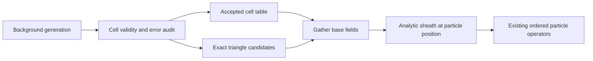

# Static background gathers and GPU execution

The structural opportunity is to reduce repeated point location and GPU bookkeeping. OpenEdge already has a Kokkos Boris mover, mesh and raster gathers, ADAS reactions, and PWI. A new host-to-device pusher port would duplicate existing work. Start by gathering all fields for one query position after one triangle search, then introduce a conservative Cartesian accelerator with an exact fallback.

## Accuracy measured on WEST

`background_audit.cpp` links to the production CPU library and calls `FixBackground::sample_point`. The input is the same 59,936-triangle plasma used by `teprobe_fixed_off`. It samples 25,025 SPARTA parent-cell boxes with positive volume. Each linear fit uses a symmetric 27-point training stencil; a separate, nonsymmetric 27-point stencil supplies 675,675 holdout points. The center model uses one center query. The near-wall bin contains 93,042 points in cells whose centroid is within 5 mm of the active wall, using `nearest_surf/grid`.

| Field and region | Center NRMSE | Linear NRMSE |
| --- | ---: | ---: |
| Electron temperature, all | 6.25% | 3.26% |
| Electron density, all | 10.19% | 4.71% |
| Electron temperature, near-wall cells | 60.51% | 35.75% |
| Electron density, near-wall cells | 48.15% | 22.35% |
| Cartesian radial E component, all | 34.06% | 17.92% |

NRMSE is `sqrt(sum(error²)/sum(reference²))`. Relative-error quantiles and explicit SI denominator floors are in `results/background_accuracy.csv`. Zero crossings can make component relative errors very large; NRMSE and absolute errors are also reported. The unconstrained linear model produced 4,171 negative electron-density predictions, including 3,982 in the near-wall bin.

These are cell-box samples, including points in the solid portion of cut cells and crossings of the plasma footprint. They are not weighted by particle occupancy. The probe tests base background fields, before the pusher's position-dependent sheath potential and Boltzmann density correction. Thus the results reject an unconditional table replacement; they do not establish a trajectory or sheath error bound. A linear fit improves bulk RMS error but does not resolve discontinuities or guarantee positivity. Clipping negative fits would introduce another approximation.

## Exact acceleration before approximation

Use one exact mesh-location result to gather scalar fields, mesh B, E, flow, and gradients at a particular position. Keep the existing distinctions between cell-centered scalar fields, triangle-averaged B, equilibrium fallback, and constant-field precedence. Intermediate Boris positions must have their own queries. The existing scalar memo and particle hints have observable edge-order behavior; do not replace them with an unrestricted shared memo.

An exact alternative to field tabulation is a Cartesian cell-to-triangle candidate list. Build a CSR list of triangles intersecting each SPARTA cell's R-Z footprint, including the full toroidal extent and `column_axis` offset. At runtime, test only those candidates. Retain the original hash traversal order for candidates on shared edges and preserve the original fallback. A cell whose entire footprint belongs to one source triangle can use that triangle directly after a validity check. This avoids smoothing plasma discontinuities and transfers naturally to a GPU.

The device currently repeats hash traversal in `MeshKokkos::query_bfield_at_point` and `query_scalars_at_point`. Split location from field gathering, share a location inside a kernel, and consider a device particle hint using the same migration-safe custom-attribute mechanism as the CPU. Measure candidate lengths and hint hit rates before choosing CSR capacity or fixed-size storage.

## Optional Cartesian field tables

Store the base plasma independently of the sheath. Prefer cylindrical B/E coefficients and rotate at the particle position; otherwise a center's Cartesian vector introduces an avoidable toroidal error. Keep Boris, sheath calculations, positions, velocities, and fit coefficients in double precision.

A possible table contains 17 doubles per cell: four thermodynamic scalars, parallel flow, three B components, three E components, and two three-component temperature gradients. At 25,872 grid cells that is about 3.52 MB globally for constants or 14.1 MB for an intercept plus three slopes, before validity masks and source metadata. This is an illustrative layout, not a measured optimal format.

Use exact queries in near-wall, mixed-footprint, discontinuous, or failed-fit cells. Subdivide only where independent holdout errors justify it. Establish provisional numerical gates, such as 1% p99 field and rate error in accepted bulk cells, then validate their physical adequacy against the existing regression tolerances and WEST wall ledgers. Do not silently enable approximate tables under the existing `background` default.

Cache keys must include `FixBackground::generation`, provider type, coordinate convention and axis offset, global cell identity, and the geometry/decomposition generation. Rebuild or migrate after `grid_changed`, adaptation, restart, or a scheduled plasma reload. The representative deck uses `static no` to permit phase updates; the plasma is static within a run segment. Local array size and first-cell ID alone are insufficient as a general cache-validity contract.

Keep `wall_flux_rescale auto|yes|no`, its sample-area normalization, nearest-sample assignment, and 2-D axisymmetric default unchanged. Wall-flux preprocessing belongs to the surface-source cache, not the volume field table.

## Rates and operator order

ADAS rates can be reused only when the actual inputs agree. The existing `rate_cache cell` uses one particle's plasma values for its cell and is an approximation near sheath density depletion; leave its default unchanged. Exact reuse can key on species, Te, ne, timestep, and relevant partner density. Hydrogen charge exchange additionally depends on the particle's energy. Impurity charge exchange uses neutral density, not electron density.

Fuse operations only where their temporal order is preserved. The current plasma cache is filled before the move and is later consumed by chemistry; gathering at the post-move position inside a fused chemistry kernel would change that contract. Preserve force half-kicks, chemistry timing, emitter ordering, per-pool RNG streams, particle insertion/deletion, and surface-event ordering. A fused implementation can carry the pre-move cache into the later reaction phase.

## GPU overhead and storage

The Kokkos host trace records approximately 26.6 `parallel_for` dispatches and 67.2 fence callbacks per rank-step, including initialization. Requested deep-copy payload averages 12.97 MB per rank-step. Surface sigma snapshots account for 6.13 MB, particle snapshots 5.45 MB, and sheath-bank snapshots another 0.73 MB. These are callback payloads in Host memory, not measured PCIe or GPU DRAM traffic.

Prioritize retry transaction cost: preserve every rollback accumulator and RNG state, but investigate active-particle subviews, sparse surface journals, or capacity checks that avoid unnecessary full snapshots. Existing PWI backups already use an execution-space instance; blindly adding that argument there achieves nothing. The sheath-bank copies in `UpdateKokkos::backup/restore` still use blocking copies. Any asynchronous change must use the same execution instance as its dependent kernels and retain a fence before host consumption. [Kokkos documents these ordering guarantees](https://kokkos.org/kokkos-core-wiki/API/core/view/deep_copy.html).

CPU `OnePart` is 120 bytes; the CUDA declaration requests 16-byte alignment, implying 128 bytes for the current fields. Particle custom vectors already provide SoA storage. First test cell reordering and a small hot-field SoA/AoSoA view behind the existing `OnePart`, migration, and restart interfaces. Measure packing cost, occupancy, branch divergence, and cache traffic. Species sorting changes which markers consume rank-local random draws; validate distributions rather than assuming identical trajectories.

AMReX provides pure SoA particles and tile-based iteration; this supports the layout direction without requiring replacement of SPARTA's container. [AMReX particle documentation](https://amrex-codes.github.io/amrex/docs_html/Particle.html) and [Smilei's adaptive-vectorization results](https://smileipic.github.io/Smilei/Understand/vectorization.html) also show why particles per cell matter. Those results are not OpenEdge speedup estimates.

## Acceptance and remaining measurements

Run the existing CPU and Kokkos regression decks, package parity and scratch `make yes-openedge`, and the exact query fingerprint. Compare WEST per-monoblock area-integrated net/deposition/erosion, retained weighted W, and reproducibility across unchanged-baseline repeats. Add an independent tally of escaped real-particle weight before claiming complete global W-budget closure; the present deck only permits an inferred escape inventory.

On a CUDA allocation, run the counter library and Nsight Systems on the same source, restart state, and output cadence. Separate H2D, D2H, D2D, memset, GPU kernels, MPI waits, and initialization. Report kernel durations and critical-path synchronization, not just callback counts. Exercise forced reaction retries with compute-sanitizer before promoting changes to rollback or asynchronous copies. Neither EOS nor the accessible Mora host provided a CUDA device in this review, and the configured `nersc` alias did not resolve.
